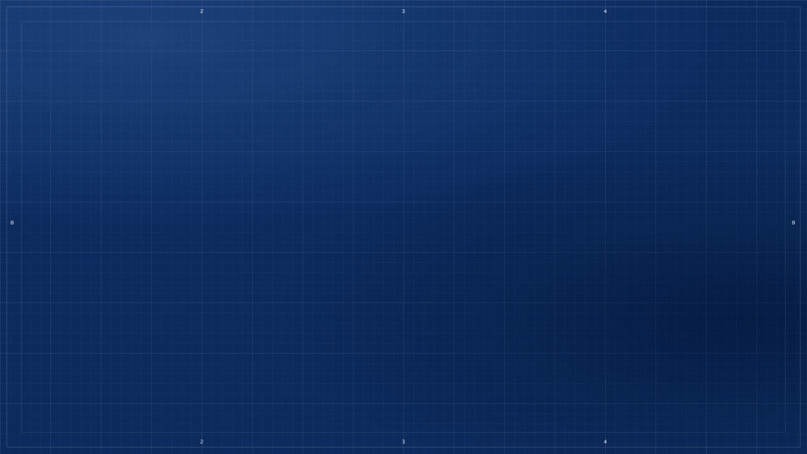

<div align="center">

# Cartographer

**The map of your system, drawn from its code.**

Point it at a repository and get an auto-laid-out, editable architecture map,
with the evidence behind every arrow. Then let CI fail the pull request when the
code drifts from it.

[](https://github.com/Sarthak-47/crtgrphr/actions/workflows/ci.yml)
[](https://github.com/Sarthak-47/crtgrphr/releases/latest)
[](LICENSE)


[**Download**](https://github.com/Sarthak-47/crtgrphr/releases/latest) ·
[Website](https://sarthak-47.github.io/crtgrphr/) ·
[GitHub Action](#keep-the-map-in-sync-cli-and-github-action) ·
[Changelog](CHANGELOG.md)



<sub>A real scan of <a href="https://github.com/spring-petclinic/spring-petclinic-microservices">spring-petclinic-microservices</a>, no hand-drawing. Then a pull request adds a service, and the map marks the drift.</sub>

</div>

## Try it in 30 seconds

**The app:** [download the installer](https://github.com/Sarthak-47/crtgrphr/releases/latest)
for Windows, macOS or Linux, click **Scan a repository** and pick any project folder.

**The command line** (Node 18+; one file, no dependencies): download `crtgrphr.mjs` from the
[latest release](https://github.com/Sarthak-47/crtgrphr/releases/latest), then

```bash
node crtgrphr.mjs scan path/to/your/repo --out architecture.crtgrphr --svg architecture.svg
```

**In CI:** add the [GitHub Action](#keep-the-map-in-sync-cli-and-github-action) and every
pull request that changes the architecture gets flagged, with a picture of what changed.

## Why it's different

- **Built from the code, not drawn from memory.** It reads Docker Compose, Kubernetes and
  Helm, Terraform, npm/pnpm/yarn workspaces, Maven, Gradle, .NET, and the imports in
  TypeScript/JavaScript, Python, Go and Rust.
- **Every arrow can say why it exists.** Click a link to see the file and setting that
  declared it (`docker-compose.yml: services.api-gateway.ports publishes 8080`), or the hint
  it was inferred from.
- **Laid out for you, still yours to edit.** Drag a box and it stays pinned while the rest
  re-flows. Group, collapse, save views, open any part's source in your editor.
- **Stays true.** Re-scan to preview what changed before applying it; your edits are kept.
  The CLI and Action fail a check when the code drifts from the committed map.
- **Private by default.** Everything runs on your machine. No account, no telemetry. The
  optional AI drafting runs on a local model with Ollama unless you opt into an API key.
- **Goes anywhere.** Export SVG, PNG, a share card, Mermaid, draw.io and C4 (PlantUML).
  Map files are plain JSON that diff cleanly in Git.

## What it is, in plain words

Cartographer is a desktop app that draws a picture of how a software system is put
together: the boxes are the parts, and the arrows show which part talks to which.

Engineers draw these all the time to explain a project to a new teammate, plan a
change, or work out what broke. Usually someone draws them by hand, and they're out
of date within weeks. Cartographer builds the picture for you, keeps it neat
automatically, and still lets you edit it.

### Three ways to get a picture

1. **Point it at a code folder.** It reads the project's files and works out the
   parts on its own: the website, the server, the database, and which part uses
   which. Nothing is uploaded; it all happens on your computer.
2. **Describe it in plain English.** For example: *"A shop website talks to a
   server, which stores orders in a database."* AI turns that into a diagram. By
   default the AI runs on your own computer, so nothing you write leaves it.
3. **Draw it yourself**, or paste in a diagram written in Mermaid, a common text
   format for diagrams.

### How it works

1. **It notes what exists, not where it goes.** First it writes down only the
   facts: these parts exist, and these arrows connect them. There's no positioning yet.
2. **It lays the picture out by itself.** A layout engine (the open-source
   [ELK](https://eclipse.dev/elk/)) arranges the boxes so the picture reads cleanly:
   arrows flow in one direction, avoid crossing where possible, and go around boxes
   instead of through them.
3. **You fix what you care about.** Drag a box and it stays where you put it (it
   gets *pinned*). Click **Auto-layout** and everything else rearranges around your
   pinned boxes. The tool does the tidying; you have the final say.
4. **It keeps up with the code.** When the project changes, click **Re-scan**. You
   see what's new, gone or changed, highlighted in green, red and yellow, and decide
   whether to accept it. Your own edits are kept.

### What else you can do

- **Group** related boxes inside a labelled frame, like "Data tier" (Ctrl+G).
  Double-click a group to **collapse** it into one box, and again to open it. Big
  repositories start with their largest groups collapsed, so the map stays readable
  without leaving anything out.
- **Click a box** to light up everything it affects downstream.
- **Pick two boxes** (Shift-click) to see the route between them.
- **Make five kinds of diagram:** a system overview, a step-by-step process, a
  conversation between parts over time, how data flows, and the states something
  moves through.
- **See why a link is there:** select a link to read the evidence the scan found
  (for example "DATABASE_URL in services.api names db") and whether it was
  declared in the code or inferred from it; inferred links have italic labels.
- **Save** your map as a `.crtgrphr` file, and **export** it as an SVG or PNG
  image, a 1200×630 card for social media or a README, Mermaid text to paste into
  documentation, a **draw.io** file (also opens in Confluence and Lucidchart), or a
  **C4** container diagram in C4-PlantUML.

### What it reads in a codebase

- `docker-compose` files: services, and which depend on which
- **Kubernetes** manifests: workloads, the Services and Ingress/Gateway routes in
  front of them, and which workload talks to which (from env vars, args and
  ConfigMaps); namespaces become groups, kustomize overlays are read once
- **Helm** charts: sub-charts and dependencies (bitnami/postgresql shows up as a
  database), images from `values.yaml`
- **Terraform**: the AWS, Google Cloud and Azure databases, caches, queues,
  functions, services, gateways and buckets, and how they connect
- npm, yarn and pnpm monorepos, grouped by workspace folder
- **Maven** and **Gradle** multi-module builds and **.NET** solutions, with Spring
  Boot, Quarkus, Micronaut, Ktor and ASP.NET Core recognised
- Node, Python, Go and Rust projects (`package.json`, `pyproject.toml`,
  `requirements.txt`, `go.mod`, `Cargo.toml`)
- the real import graph of JavaScript/TypeScript and Python code
- well-known infrastructure the code depends on, such as Postgres, SQL Server,
  Redis, Kafka, RabbitMQ, Stripe, AWS and Azure

## Keep the map in sync (CLI and GitHub Action)

A map is only worth having while it matches the code. Commit it next to the code
and let CI tell you when it goes stale.

**The command-line tool** is one file, `crtgrphr.mjs` (attached to each
[release](https://github.com/Sarthak-47/crtgrphr/releases/latest), and at
`action/dist/` in this repo). It needs Node 18 or newer and nothing else.

```bash
# make a map, plus Mermaid for the README and an SVG
node crtgrphr.mjs scan . --out docs/architecture.crtgrphr --mermaid docs/architecture.md --svg docs/architecture.svg

# in CI: exit 1, with a Markdown report, when the code no longer matches the map
node crtgrphr.mjs check --map docs/architecture.crtgrphr --report drift.md

# bring the map up to date (your edits, pins and hand-added parts are kept)
node crtgrphr.mjs scan . --out docs/architecture.crtgrphr
```

**The GitHub Action** runs the same check on every pull request and puts the drift
report in the job summary:

```yaml
on: pull_request
permissions:
  contents: read
  pull-requests: write   # only needed for comment: true
jobs:
  architecture:
    runs-on: ubuntu-latest
    steps:
      - uses: actions/checkout@v5
      - uses: Sarthak-47/crtgrphr@v1.4.0
        with:
          map: docs/architecture.crtgrphr   # created on the first run if missing
          mode: check                        # or "update" to rewrite it for a commit step
          mermaid: docs/architecture.md      # optional exports: mermaid, svg, drawio, c4
          comment: true                      # optional: post the drift report on the PR
```

By default only the structure counts as drift: parts or links added or removed,
parts renamed or changing kind. Set `strict: true` to also count details such as
file counts. Set `helm: true` to render Helm charts with `helm template` (helm is
preinstalled on GitHub's runners), so the map shows the workloads a chart deploys
rather than the chart. For a big map, save a view in the app (some groups collapsed)
and set `view: Overview` to export that instead of everything.
Cartographer checks its own map this way: see
[`docs/architecture.md`](docs/architecture.md).

## Install

Download the installer for your system from the
[latest release](https://github.com/Sarthak-47/crtgrphr/releases/latest):
Windows (`.exe`), macOS (`.dmg`) or Linux (`.AppImage`).

The installers are not code-signed (signing certificates cost money), so your system
warns the first time you open the app:

- **Windows:** on the SmartScreen prompt, click **More info**, then **Run anyway**.
- **macOS:** right-click the app, choose **Open**, then confirm **Open**.

Supported systems: Windows 10 or newer, macOS 12 (Monterey) or newer on Apple
silicon, and 64-bit Linux.

### Check a download

The installers aren't code-signed, but each release lists their SHA-256 checksums
(`SHA256SUMS.txt`) and carries signed build provenance from GitHub Actions, so you
can confirm a file is exactly what this repository's CI built:

```bash
gh attestation verify Cartographer-Setup-1.4.0.exe --repo Sarthak-47/crtgrphr
```

Each release also includes a software bill of materials (`*-sbom.cdx.json`,
CycloneDX) listing every dependency, Electron included.

### Using the AI features

- **Local (default):** install [Ollama](https://ollama.com), pull any model you like,
  and pick it in **AI settings**. Nothing leaves your computer.
- **Anthropic API (optional):** in **AI settings**, switch provider and paste your
  own API key. It is encrypted with your system keychain, and the app tells you each
  time a description will be sent to Anthropic.

## Build from source

Requires Node.js 22.12+. Dependencies and caches stay inside the project folder (see
`.npmrc` and `scripts/install.mjs`); nothing is installed globally.

```bash
node scripts/install.mjs   # npm ci, with Electron's download kept in .electron-cache
npm run dev        # launch the app with hot reload
npm test           # unit tests (Vitest)
npm run e2e        # build, then drive the real Electron app end to end
npm run check      # typecheck + unit tests + build
npm run dist       # build an installer for this OS into release/
```

## How it's built

- **Electron** desktop app, so it can read code folders directly, with **React** and
  **TypeScript** for the interface and **React Flow** for the canvas.
- **ELK** for automatic layout.
- One typed data model sits at the centre: every way in (scan, AI, Mermaid, hand
  editing) produces it, and every way out (canvas, exports, saved files) reads it.
  It stores no coordinates; positions live in a separate layer, which is what makes
  pin-and-reflow work.
- A command-line build of the same scanner, layout and exporters runs in CI
  without Electron (see above).
- Around 280 unit tests check the logic (including property-based tests that throw
  random, hostile input at the file loader and the import scanner), and an end-to-end test drives the real app
  like a person would. GitHub Actions runs them on Windows and Linux for every
  change, and builds the installers for each release.

## Why it exists

Existing tools force a trade-off:

- **Mermaid and other diagrams-as-code:** versionable text, but rigid layout and
  static output.
- **Whiteboards like Excalidraw or Figma:** endlessly editable, but nothing is
  grounded in the real system, so they rot quickly.
- **[Archify](https://github.com/tt-a1i/archify)**, which inspired this project:
  validated and interactive, but an AI has to place every box by exact coordinates,
  the output is a frozen HTML file, and it can't read real code.

Cartographer's bet is that you can have **auto-layout you can still edit by hand**,
fed by **maps grounded in real code**, in one tool. Cartographer is a clean-room
build; see [NOTICE](NOTICE).

## Project docs

| Doc | What it covers |
|---|---|
| [`docs/vision.md`](docs/vision.md) | Problem, audience, positioning |
| [`docs/features.md`](docs/features.md) | The feature set, with tiers and effort estimates |
| [`docs/design.md`](docs/design.md) | Architecture and data model |
| [`docs/build-plan.md`](docs/build-plan.md) | Milestones M0–M5 and what each delivered |
| [`docs/decisions/`](docs/decisions/) | Architecture decision records (ADRs) |
| [`docs/architecture.md`](docs/architecture.md) | Cartographer's own map, generated and checked by itself |
| [`docs/open-questions.md`](docs/open-questions.md) | Decisions made in the design session |
| [`CONTRIBUTING.md`](CONTRIBUTING.md) | Workflow, tests, packaging and releases |

## Team

Built solo by **Sarthak**. Design-first: each decision is discussed and recorded
before the code it implies is written.
